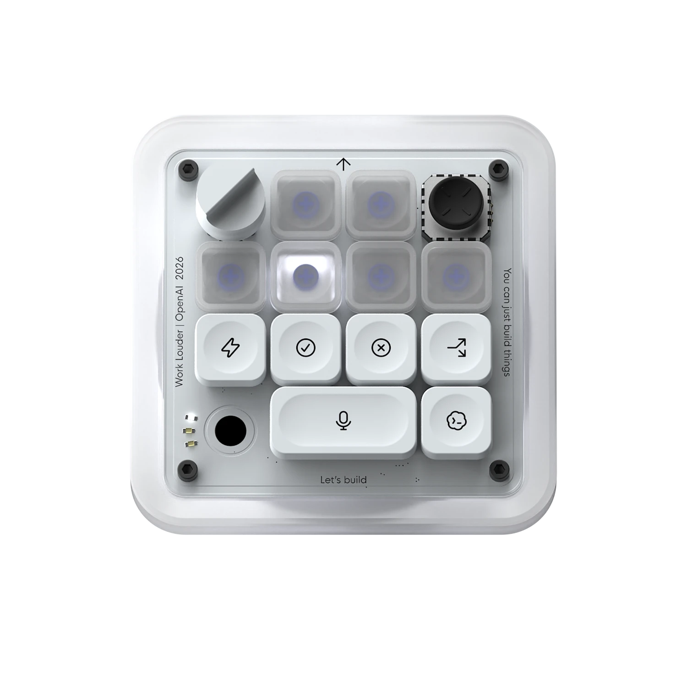

<p align="center">
  
</p>

<h1 align="center">Codex Micro for Stream Deck</h1>

<p align="center">
  A native-feeling, macOS-only Stream Deck controller for the Codex desktop experience.<br />
  Five live task buttons, direct effort and Fast controls, approvals, branching, dictation and submit.
</p>

<p align="center">
  
  
  
  <a href="https://github.com/renehagen/codex-micro-streamdeck/actions/workflows/ci.yml"></a>
</p>

## What it does

Codex Micro turns a 5×3 Stream Deck MK.2 into a focused Codex control surface. The top row follows your five most recent local Codex tasks and displays their live state. The remaining keys mirror the useful controls from the [Work Louder × OpenAI Codex Micro](https://openai.com/supply/co-lab/work-louder/) layout, without its joystick.

| | Column 1 | Column 2 | Column 3 | Column 4 | Column 5 |
|---|---|---|---|---|---|
| **Top** | Session 1 | Session 2 | Session 3 | Session 4 | Session 5 |
| **Middle** | Effort + | Fast | Accept | Reject | Branch |
| **Bottom** | Effort − | X | Push to talk | — | Submit |

The effort buttons follow the exact sequence exposed by the current Codex widget:

`Low → Medium → High → Extra High → Ultra`

### Live session states

| Colour | Meaning |
|---|---|
| Grey | Idle |
| Green | Completed and unread |
| Blue | Thinking or running |
| Peach | Waiting for approval or input |
| Red | Error |

Pressing a session key opens that task in the Codex desktop app and marks it as read. Pressing X launches the installed X app. Selecting one of these five tasks with the mouse in Codex also moves the Stream Deck selection automatically. Effort and Fast recheck the visible task immediately before applying a change, so a recent mouse selection cannot send the update to the previously selected task.

## Requirements

- macOS 13 or newer
- Elgato Stream Deck 7.1 or newer
- Stream Deck MK.2 for the bundled 5×3 profile
- The current ChatGPT/Codex desktop app, signed in and running
- Node.js 24 or newer for development and packaging

## Install from source

```bash
git clone https://github.com/renehagen/codex-micro-streamdeck.git
cd codex-micro-streamdeck
npm ci
npm run setup
npm run pack
open dist/com.renehagen.codex-micro.streamDeckPlugin
```

`npm run setup` safely merges the required F13–F18 Codex keybindings into `~/.codex/keybindings.json`. Existing bindings are preserved and an existing file is backed up. Restart the desktop app once after setup.

On first use, macOS may request **Accessibility** and **Input Monitoring** access for Stream Deck or System Events. These permissions are required for approvals, branching, submit and push-to-talk.

## How it works

- The official Stream Deck Node SDK hosts the plugin.
- `codex app-server` supplies the five most recent local tasks.
- Append-only rollout logs under `~/.codex/sessions` provide live task status.
- Effort and Fast update existing tasks directly through the local desktop IPC router. In a new, empty task they fall back to the native composer commands until Codex assigns a task ID.
- The selected session follows Codex's targeted active-task signal. Ambiguous or unavailable responses are ignored, retaining the last explicit Stream Deck selection instead of guessing.
- The local Codex state database supplies the current effort in milliseconds and keeps rapid repeated presses ordered correctly.
- Accept, reject and branch use dedicated F13–F18 Codex keybindings. Submit uses the active composer's native Enter action, avoiding unreliable synthetic F19 delivery on macOS.
- Push-to-talk activates Codex and sends the held dictation key in one macOS action, while always releasing it during cleanup.

There is no hosted backend, account integration or telemetry in this project. All communication stays between Stream Deck, the local desktop app and files under your Codex home directory.

## Development

```bash
npm ci
npm run build
npm test
npm run validate
npm run smoke
```

Useful commands:

| Command | Purpose |
|---|---|
| `npm run assets` | Regenerate all Stream Deck key artwork |
| `npm run profile:generate` | Rebuild the bundled MK.2 profile |
| `npm run profile:install` | Install into an empty local `Profile 1`, with backup |
| `npm run setup` | Merge the Codex F13–F18 keybindings |
| `npm run link` | Link the plugin into Stream Deck for development |
| `npm run smoke` | Run a read-only bridge check against recent local tasks |
| `npm run pack` | Build, validate and package the installer |

Project layout:

```text
src/                                  Plugin, bridge, IPC and rendering code
tests/                                Unit and integration-style tests
scripts/                              Reproducible build, asset and profile tools
assets/reference/                     Source references for key artwork
com.renehagen.codex-micro.sdPlugin/   Stream Deck manifest, images and profile
```

## Compatibility note

The effort and Fast integration talks to a local IPC surface of the desktop app. It is intentionally isolated behind tests, but a future desktop update may require an adapter change.

## Attribution

This is an independent community project inspired by the Codex Micro collaboration from OpenAI and Work Louder. It is not affiliated with or endorsed by OpenAI, Work Louder or Elgato. Product names, artwork and trademarks belong to their respective owners.

## License

The original source code in this repository is available under the [MIT License](LICENSE). You may use, modify, distribute and sell it, provided that the copyright and licence notice remain included.

The MIT License does not grant rights to third-party product imagery, logos, brand names, trademarks or reference artwork in `assets/reference/`, nor to generated key artwork derived from those references. Those materials remain subject to the rights of their respective owners.
